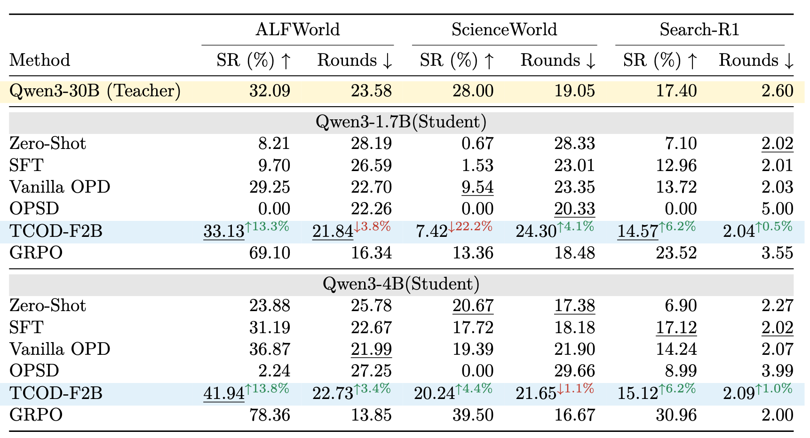
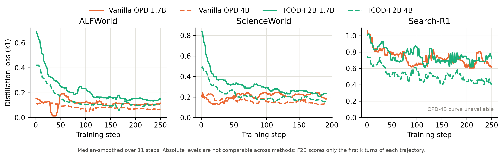
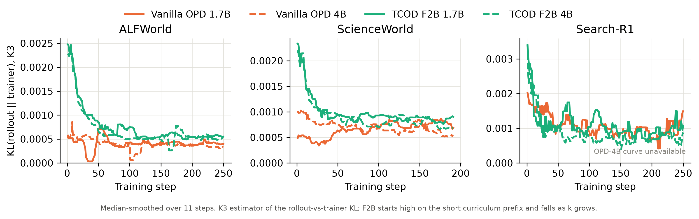

# stepopd：多轮 RL 的 SFT / GRPO / OPD 实验分析对比

针对OPD探索在多轮交互场景下的表现和优化方式，在AlfWorld, ScienceWorld, Search-R1等数据集上执行OPD，SFT，GRPO的训练，评估训练效果，为解决OPD在长程交互中KL散度不稳定的问题，引入课程学习的做法，采用F2B的策略复线TCOD的实验。

## 1. 代码结构

```text
stepopd/
├── src/stepopd/
│   ├── opd/                    
│   │   ├── alfworld/           
│   │   ├── scienceworld/       
│   │   └── search_r1/          
│   ├── tcod_f2b/               
│   ├── opsd/                   
│   ├── sft/                    
│   ├── grpo/                   
│   ├── eval/                   
│   └── runtime/                
├── patches/                    
└── images/                     
```

## 2. 实验设置

教师为未经微调的 Qwen3-30B-A3B-Instruct。训练环境：ALFWorld 3553 / ScienceWorld 2294 / Search-R1 90312 条；评测环境：ALFWorld Valid Unseen 134、ScienceWorld 1308、Search-R1 7405。学生模型为同架构的Qwen3-1.7B 和 Qwen3-4B模型。

- 学生 rollout 温度 1.0，`train_batch_size=12`，`lr=1e-6` 恒定，1 epoch，步数上限250；checkpoint 每 25 步保存。
- 上下文 16K = prompt 2048 + response 14336；每轮生成上限 1024 token。
- GPU 拓扑：OPD/F2B 学生 6 卡 + 教师 2 卡（vLLM TP=2）；GRPO 8 卡；OPSD 6 卡。
- 异步训练：colocate async，staleness > 2 的轨迹丢弃。
- OPD使用 k1 loss + PG，`use_policy_gradient=true`、`use_task_rewards=false`、`loss_max_clamp=15`；`use_kl_loss=false`。

## 3. 实验结果



GRPO算法稳定优于OPD类方法，甚至可以超过教师模型的表现，结果导向的RL方法比教师模型的指导更为可靠。OPSD方法出现训练崩溃，相比于原始模型甚至没有出现稳定增益，自蒸馏在小参数模型上不可靠。课程学习的做法如TCOD-F2B在大多数指标上优于OPD，通过一定的课程学习，可以增强OPD在长程交互上的表现，甚至可以超过教师模型。

## 4. 训练动态：loss 与 KL

蒸馏损失：



KL散度：



相比于Vanilla OPD, 课程学习允许学生模型从易到难逐步学习，可以观察到其损失下降更为迅速，KL散度值在训练后期趋于稳定，相对于OPD有更小的波动幅度。

## 5. 复现

下载并配置 AlfWorld, ScienceWorld, Search-R1的数据及环境配置。

```bash
# 1) verl 0.9.0
git clone --depth 1 --branch v0.9.0 https://github.com/volcengine/verl.git verl
git apply -p1 patches/verl-0.9.0-agent-loop.patch

# 2) Python / 环境依赖（Python 3.12、torch 2.11、vLLM 0.24）
pip install -r requirements.txt
pip install -e ".[environments,retrieval]"   # 按需
source configs/env/container.sh               # STEPOPD_ROOT / PYTHONPATH=src:verl / Java

# 3) 数据：源数据放到 envs/
python -m stepopd.opd.prepare --environment alfworld --data-dir envs/alfworld
python -m stepopd.opd.check --environment alfworld

# 4) 单实验训练（config-path 需绝对路径）
python -m stepopd.opd.train \
  --config-path "$PWD/src/stepopd/opd/alfworld/scripts" --config-name opd_30b_to_1p7b

# 5) 各方法 
bash scripts/opd_suite.sh
bash scripts/train_entrypoint.sh --help      # 其余入口见 src/stepopd/{tcod_f2b,opsd,sft,grpo}/
```

## 6. 许可与致谢

[Apache-2.0](./LICENSE)

- 训练框架 [verl](https://github.com/volcengine/verl) 0.9.0
- SKILL 来自 [AgentOPSD](https://github.com/ZethWang/AgentOPSD)
